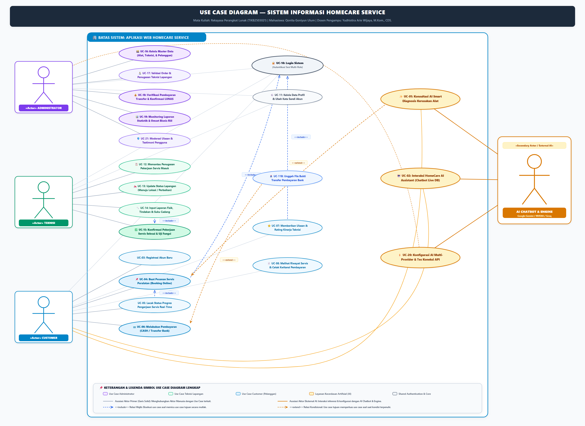
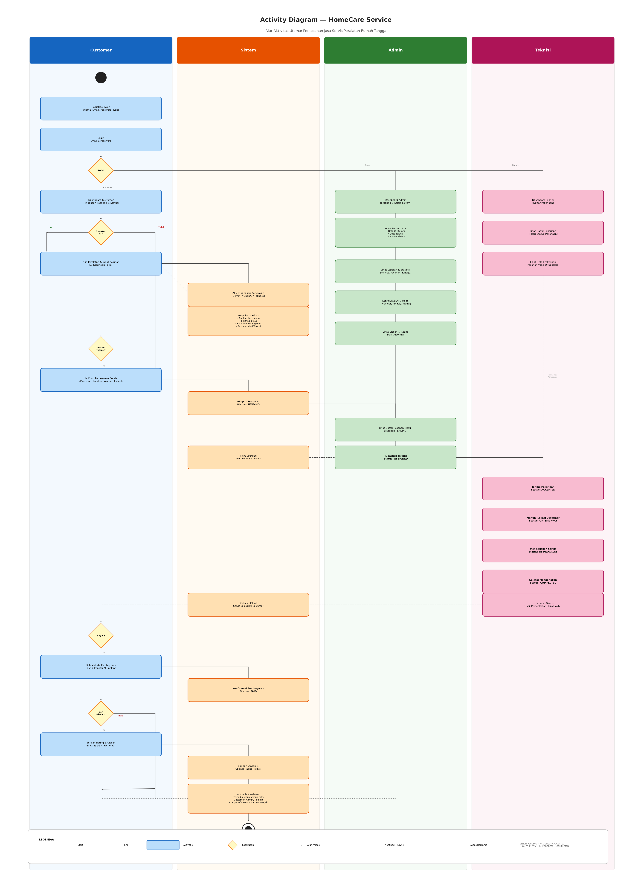

# 🏠 HomeCare Service — Platform Jasa Servis Peralatan Rumah Tangga Berbasis AI

[](https://php.net/)
[](https://en.wikipedia.org/wiki/Model%E2%80%93view%E2%80%93controller)
[](https://mysql.com/)
[](https://getbootstrap.com/)
[](https://ai.google.dev/)

> **Proyek Akhir Rekayasa Perangkat Lunak (TIKB2503021) — Semester 3**  
> **Program Studi:** S1 Teknik Informatika, **STMIK IKMI Cirebon**  
> **Dosen Pengampu:** Yudhistira Arie Wijaya, M.Kom., CDS.  
> **Pengembang (Mahasiswa):** Qonita Goniyun Ulum (*Pengerjaan Mandiri / Full-App Build*)

---

## 📌 Tentang Proyek

**HomeCare Service** adalah aplikasi berbasis web yang dirancang untuk mempermudah masyarakat dalam melakukan pemesanan jasa perbaikan dan perawatan peralatan rumah tangga (AC, Kulkas, Mesin Cuci, Pompa Air, Kompor Listrik/Gas, Kipas Angin, Dispenser, Blender, Microwave, Setrika, TV, dll.).

Aplikasi ini mengintegrasikan **Kecerdasan Buatan (Artificial Intelligence)** melalui:
1. **AI Smart Diagnosis**: Menganalisis kerusakan peralatan sebelum teknisi datang, mengestimasi kisaran biaya perbaikan, serta memberikan panduan penanganan awal yang aman di rumah.
2. **HomeCare AI Assistant (Chatbot Live Database)**: Asisten percakapan cerdas dua arah yang terhubung langsung dengan basis data sistem, siap menjawab pertanyaan mengenai status pesanan, data pelanggan terdaftar, omset bisnis, ketersediaan teknisi, hingga katalog tarif alat.

---

## ✨ Fitur-Fitur Utama

### 1. 👤 Modul Customer (Pelanggan)
* **Katalog Alat & Tarif Dasar**: Eksplorasi daftar peralatan rumah tangga yang didukung beserta estimasi biaya perbaikan.
* **AI Smart Diagnosis**: Konsultasi kerusakan berbasis AI yang menghasilkan analisis kerusakan, faktor penyebab, estimasi biaya wajar, panduan mandiri, dan rekomendasi teknisi.
* **Order Booking Online**: Formulir pemesanan praktis dengan integrasi tombol satu-klik dari hasil diagnosis AI, jadwal kedatangan teknisi, alamat lengkap, dan unggah foto kerusakan.
* **Pelacakan Status Real-Time**: Pantau status servis secara transparan (*Pending → Assigned → Accepted → On The Way → In Progress → Completed*).
* **Pembayaran Fleksibel**: Pilihan metode pembayaran Tunai (*Cash on Delivery*) atau Transfer M-Banking / E-Wallet (BCA, Mandiri, BRI, ShopeePay, DANA, GoPay) dengan fitur unggah bukti transfer.
* **Cetak Kuitansi Elektronik (*E-Receipt*)**: Unduh kuitansi resmi berstempel lunas setelah servis selesai dan pembayaran terkonfirmasi.
* **Rating & Ulasan Teknisi**: Berikan ulasan bintang 1–5 dan testimoni atas hasil kerja teknisi.

### 2. 🔧 Modul Teknisi Lapangan
* **Manajemen Pekerjaan Servis**: Dashboard ringkas untuk memantau pesanan yang ditugaskan (*Assigned*).
* **Pembaruan Status Lapangan Interaktif**:
  * `ACCEPTED` : Konfirmasi penerimaan order.
  * `ON_THE_WAY` : Konfirmasi teknisi dalam perjalanan (notifikasi otomatis ke customer).
  * `IN_PROGRESS` : Teknisi mulai mengerjakan perbaikan di lokasi.
  * `COMPLETED` : Servis tuntas setelah pengujian fungsi alat.
* **Pengisian Laporan Servis Fisik**: Form pencatatan hasil inspeksi teknis, tindakan perbaikan, pergantian suku cadang, dan penentuan total biaya tagihan akhir (*final cost*).

### 3. 🛡️ Modul Administrator
* **Dashboard Statistik Real-Time**: Ringkasan total pesanan, omset pendapatan lunas, rasio kepuasan pelanggan, dan status antrean servis.
* **Validasi & Penugasan Teknisi (*Order Dispatch*)**: Meninjau pesanan `PENDING` dan menugaskan teknisi yang berstatus *Available*.
* **Kelola Master Data (CRUD Lengkap)**:
  * Master Data Pelanggan (*Customer*)
  * Master Data Teknisi (*Technician & Spesialisasi*)
  * Master Data Katalog Peralatan & Tarif Dasar (*Equipment*)
* **Konfigurasi AI Multi-Provider**: Pengaturan API Key dan model AI (Google Gemini, NVIDIA NIM, OpenAI, Groq) dilengkapi tombol pengujian koneksi langsung (*live connection test*).
* **Laporan Finansial & Analitik Bisnis**: Rekap omset bulanan/tahunan, performa teknisi, dan ekspor data.
* **Moderasi Ulasan & Rating**: Pengawasan kepuasan pelanggan terhadap layanan yang diberikan.

### 4. 🤖 Fitur AI & Notifikasi Terpadu
* **Integrasi AI Multi-Provider**: Dukungan Google Gemini (`gemini-2.5-flash`), NVIDIA NIM, OpenAI, Groq, serta *Smart Fallback Diagnosis Engine* lokal jika koneksi internet/API dibatasi.
* **Notifikasi Multi-Channel**:
  * Notifikasi Web In-App (Real-time bell alert).
  * Notifikasi WhatsApp Otomatis via Fonnte API.
  * Notifikasi Telegram Client via MTProto Userbot.

---

## 📐 Diagram UML Sistem

### 1. Use Case Diagram
Menggambarkan interaksi antara 4 aktor (Customer, Admin, Teknisi, dan Sistem AI Eksternal) dengan 20 skenario use case utama sistem.



📄 **Dokumentasi Lengkap Use Case:** Baca selengkapnya di [docs/USECASE_DOCUMENTATION.md](docs/USECASE_DOCUMENTATION.md).

---

### 2. Activity Diagram
Menggambarkan alur aktivitas operasional end-to-end dengan 4 swim lane aktor (*Customer, Sistem, Admin, Teknisi*), percabangan keputusan (*Decision Nodes*), dan siklus hidup pesanan.



📄 **Dokumentasi Lengkap Activity Diagram:** Baca selengkapnya di [docs/ACTIVITY_DIAGRAM_DOCUMENTATION.md](docs/ACTIVITY_DIAGRAM_DOCUMENTATION.md).

---

## 🔄 Siklus Hidup Pesanan (*Order Lifecycle*)

```
[Customer] Buat Pesanan
          │
          ▼
       PENDING ──────────────┐
          │ (Admin Assign)   │
          ▼                  │
       ASSIGNED              │ (Batal)
          │ (Teknisi Terima) │
          ▼                  ▼
       ACCEPTED          CANCELLED
          │ (Teknisi Jalan)
          ▼
      ON_THE_WAY
          │ (Tiba di Lokasi)
          ▼
     IN_PROGRESS
          │ (Selesai Servis & Laporan)
          ▼
      COMPLETED
          │ (Customer Bayar: Cash/Transfer)
          ▼
        PAID ──> Review & Rating (⭐ 1-5)
```

---

## 🏗️ Struktur Direktori Proyek (Arsitektur MVC)

```
jasa peralatan runah tangga/
├── app/
│   ├── Config/              # Konfigurasi Database (PDO Singleton) & App Constants
│   ├── Controllers/         # Controller MVC (Auth, Customer, Teknisi, Admin, AI)
│   ├── Core/                # Framework Core (Controller base, Model base, Router, Middleware)
│   ├── Models/              # Model database (ServiceOrder, User, Technician, Equipment, Payment, dll)
│   ├── Services/            # Service Layer (AIService, DatabaseContextService, FonnteService, TelegramService)
│   └── Views/               # Template tampilan Bootstrap 5 (Layouts, Auth, Customer, Teknisi, Admin)
├── database/
│   ├── schema.sql           # Skema DDL tabel database
│   ├── seed.php             # Script seeder data awal
│   └── backup_homecare_db.sql # Full dump database siap pakai
├── docs/
│   ├── USECASE_DOCUMENTATION.md          # Rincian 20 use case & relasi stereotipe UML
│   └── ACTIVITY_DIAGRAM_DOCUMENTATION.md # Rincian swim lane & urutan aktivitas
├── public/                  # Web root publik
│   ├── css/                 # Custom stylesheet (style.css)
│   ├── js/                  # Script JavaScript (main.js)
│   ├── uploads/             # Folder penyimpanan file upload (foto kerusakan & slip transfer)
│   ├── .htaccess            # Apache rewrite rule menuju public/index.php
│   └── index.php            # Front Controller aplikasi
├── routes/
│   └── web.php              # Definisi seluruh rute URL & proteksi Role Middleware
├── telegram_userbot/        # Script Python automasi notifikasi Telegram MTProto
├── tests/                   # Unit test & integrasi pengujian Fonnte API
├── .env.example             # Contoh template konfigurasi environment
├── .gitignore               # Konfigurasi file yang diabaikan oleh Git
├── PRD.md                   # Product Requirements Document resmi
├── activity_diagram_homecare_service.png # Diagram Activity resolusi 4K
├── usecase_homecare_service.png          # Diagram Use Case resolusi tinggi
└── README.md                # Dokumentasi utama proyek
```

---

## 🚀 Panduan Instalasi & Menjalankan Proyek

### 1. Prasyarat Sistem
* **Web Server**: Apache (XAMPP / WampServer / LAMP)
* **PHP**: Versi **8.1** atau lebih baru (Ekstensi aktif: `pdo_mysql`, `curl`, `json`, `mbstring`)
* **Database**: MySQL versi 5.7+ atau MariaDB 10.4+
* **Web Browser**: Google Chrome / Microsoft Edge / Mozilla Firefox terbaru

### 2. Langkah-Langkah Instalasi

1. **Clone Repositori:**
   ```bash
   git clone https://github.com/Qonita017/projek-rpl-homecare-service.git "C:\xampp\htdocs\jasa peralatan runah tangga"
   ```

2. **Setup Basis Data:**
   * Buka panel **phpMyAdmin** di browser (`http://localhost/phpmyadmin/`).
   * Buat database baru bernama `homecare_db`.
   * Impor berkas database:
     * Pilih database `homecare_db` $\rightarrow$ Klik tab **Import**.
     * Pilih berkas `database/backup_homecare_db.sql` $\rightarrow$ Klik **Go / Kirim**.

3. **Konfigurasi Environment (`.env`):**
   * Salin berkas `.env.example` menjadi `.env`:
     ```bash
     copy .env.example .env
     ```
   * Sesuaikan kredensial database dan API key jika diperlukan:
     ```ini
     DB_HOST=127.0.0.1
     DB_USER=root
     DB_PASS=
     DB_NAME=homecare_db

     # AI API Configuration (Opsional: Google Gemini / NVIDIA NIM)
     AI_API_KEY=your_api_key_here
     AI_PROVIDER=gemini
     AI_MODEL=gemini-2.5-flash
     ```

4. **Jalankan Aplikasi:**
   * Pastikan modul **Apache** dan **MySQL** pada XAMPP Control Panel dalam status **Running**.
   * Buka browser dan akses URL:
     ```
     http://localhost/jasa peralatan runah tangga/
     ```

---

## 🔑 Akun Uji Coba (*Demo Credentials*)

Sistem telah dilengkapi data awal (*seeded data*) untuk kemudahan pengujian setiap peran:

| Peran (*Role*) | Alamat Email | Kata Sandi (*Password*) | Hak Akses Utama |
|:---|:---|:---|:---|
| **Administrator** | `admin@homecare.com` | `password` | Kelola Order, Tugaskan Teknisi, Master Data, Setting AI, Laporan Omset |
| **Teknisi** | `budi@homecare.com` | `password` | Terima Job, Update Status Lapangan, Input Laporan Servis & Biaya |
| **Customer** | `qonita@example.com` | `password` | Konsultasi AI, Booking Servis, Bayar Tagihan, Beri Ulasan |

> 💡 *Pengguna baru juga dapat langsung mendaftar secara mandiri melalui menu **Daftar Akun** pada halaman utama.*

---

## 🛠️ Teknologi yang Digunakan

* **Backend**: PHP Native (Objek Terorientasi / OOP) dengan Pola Desain MVC murni tanpa framework eksternal berat.
* **Database Access**: PDO (*PHP Data Objects*) dengan *Prepared Statements* untuk proteksi maksimal dari serangan *SQL Injection*.
* **Routing & Middleware**: Router kustom terpusat dengan *Role-Based Access Control* (`auth`, `guest`, `role:ADMIN|TEKNISI|CUSTOMER`).
* **Frontend**: HTML5, Modern CSS3, JavaScript (ES6+), Bootstrap 5.3, Bootstrap Icons & FontAwesome.
* **AI & NLP Engine**: Google Gemini API, NVIDIA NIM API, Smart Heuristic Local Fallback Engine.
* **Messaging APIs**: Fonnte WhatsApp Gateway API & Pyrogram Telegram MTProto Userbot.

---

## 📄 Dokumen Pendukung Lainnya

* 📑 **Product Requirements Document (PRD):** [PRD.md](PRD.md)
* 📐 **Dokumentasi Use Case Diagram UML:** [docs/USECASE_DOCUMENTATION.md](docs/USECASE_DOCUMENTATION.md)
* 📊 **Dokumentasi Activity Diagram UML:** [docs/ACTIVITY_DIAGRAM_DOCUMENTATION.md](docs/ACTIVITY_DIAGRAM_DOCUMENTATION.md)
* 🎬 **Naskah & Script Video Presentasi Proyek Akhir:** [Naskah_Script_Video_Proyek_Akhir_HomeCare_Service.pdf](Naskah_Script_Video_Proyek_Akhir_HomeCare_Service.pdf)

---

## 👩‍💻 Pengembang (*Author*)

* **Nama:** Qonita Goniyun Ulum
* **Institusi:** Program Studi S1 Teknik Informatika — STMIK IKMI Cirebon
* **Repositori GitHub:** [https://github.com/Qonita017/projek-rpl-homecare-service](https://github.com/Qonita017/projek-rpl-homecare-service)

---

*© 2026 HomeCare Service. Dikembangkan untuk memenuhi Ujian Akhir Semester Mata Kuliah Rekayasa Perangkat Lunak.*
