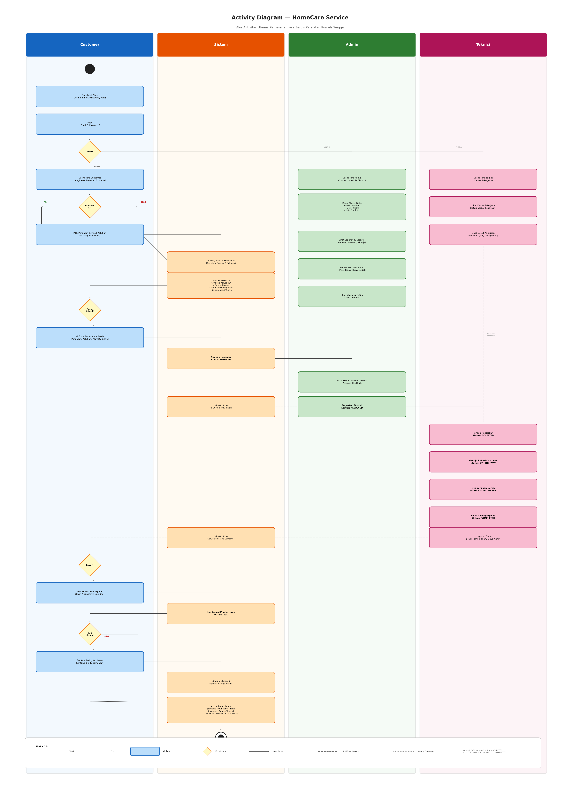

# 📊 Dokumentasi Activity Diagram UML — HomeCare Service

**Mata Kuliah:** Rekayasa Perangkat Lunak (TIKB2503021) — Semester 3  
**Institusi:** Program Studi S1 Teknik Informatika, STMIK IKMI Cirebon  
**Dosen Pengampu:** Yudhistira Arie Wijaya, M.Kom., CDS.  
**Mahasiswa:** Qonita Goniyun Ulum  
**Pengerjaan:** Mandiri (*100% Individual Ownership & Full-App Build*)

---

## 🖼️ Gambar Activity Diagram UML (Resolusi Tinggi 4086 x 5611 px)



---

## 📌 Deskripsi Activity Diagram

Activity Diagram ini menggambarkan **alur aktivitas utama** pada sistem **HomeCare Service** — platform pemesanan jasa servis peralatan rumah tangga secara end-to-end. Diagram menggunakan **4 swim lane** untuk memvisualisasikan tanggung jawab serta interaksi antar aktor:

| No | Swim Lane | Deskripsi Peran |
|:--:|-----------|-----------------|
| 1 | **Customer** | Pengguna pemilik peralatan rumah tangga yang memesan jasa servis, berkonsultasi dengan AI, membayar, dan memberi ulasan. |
| 2 | **Sistem** | Komponen backend otomatis, mesin AI Diagnosis, AI Chatbot (koneksi database live), dan dispatcher notifikasi. |
| 3 | **Admin** | Administrator yang memvalidasi pesanan masuk, menugaskan teknisi, memantau laporan analitik, dan mengelola master data. |
| 4 | **Teknisi** | Tenaga ahli yang menerima penugasan, melakukan perjalanan ke lokasi, mengeksekusi perbaikan, dan menginput laporan servis fisik. |

---

## 🔄 Alur Siklus Hidup Pesanan (*Order Lifecycle*)

```
[Customer Buat Pesanan] ──> PENDING
                               │
                       (Admin Tugaskan Teknisi)
                               │
                               ▼
                            ASSIGNED
                               │
                       (Teknisi Terima Job)
                               │
                               ▼
                            ACCEPTED
                               │
                       (Teknisi Berangkat)
                               │
                               ▼
                           ON_THE_WAY
                               │
                       (Teknisi Mulai Servis)
                               │
                               ▼
                          IN_PROGRESS
                               │
                    (Teknisi Selesai & Input Laporan)
                               │
                               ▼
                           COMPLETED
                               │
                      (Customer Bayar: Cash/Transfer)
                               │
                               ▼
                             PAID
```

---

## 📋 Rincian Tahapan Aktivitas

### 1. Registrasi & Autentikasi Sesi
1. Pengguna membuka sistem dan melakukan registrasi akun baru (Nama, Email, Password, Role).
2. Pengguna melakukan login dengan kredensial yang valid.
3. Node keputusan mendeteksi peran pengguna:
   - **Customer** $\rightarrow$ Diarahkan ke Dashboard Customer.
   - **Admin** $\rightarrow$ Diarahkan ke Dashboard Admin.
   - **Teknisi** $\rightarrow$ Diarahkan ke Dashboard Teknisi.

### 2. Konsultasi AI Smart Diagnosis (Opsional)
1. Customer memilih apakah ingin mendiagnosis kerusakan alat terlebih dahulu atau langsung order:
   - **Gunakan AI (Ya):** Customer memilih kategori peralatan dan memasukkan keluhan/gejala kerusakan.
   - Sistem AI (Gemini / NVIDIA / OpenAI / Fallback Engine) menganalisis data secara real-time.
   - Sistem menampilkan 5 kartu informasi:
     - *Analisis Kerusakan Komponen*
     - *Faktor Penyebab Utama*
     - *Estimasi Perkiraan Biaya Servis*
     - *Panduan Penanganan Awal yang Aman di Rumah*
     - *Saran & Rekomendasi Pemeriksaan Teknisi*
   - Customer dapat menekan tombol **"Pesan Teknisi dengan Hasil Diagnosa Ini"** untuk menyalin data otomatis ke formulir booking.
   - **Langsung Pesan (Tidak):** Customer langsung diarahkan ke form pemesanan servis.

### 3. Pembuatan Pesanan Servis (*Service Booking*)
1. Customer melengkapi data: jenis peralatan, keluhan, alamat lengkap, dan jadwal rencana servis (opsional: unggah foto kerusakan).
2. Sistem memvalidasi dan menyimpan pesanan ke database dengan status awal **`PENDING`**.

### 4. Validasi & Penugasan Teknisi (Admin)
1. Admin memantau daftar pesanan masuk berstatus `PENDING` pada Admin Dashboard.
2. Admin memilih teknisi yang bertatus *Available* dan menugaskannya ke pesanan.
3. Status pesanan diperbarui menjadi **`ASSIGNED`**.
4. Sistem secara asinkron mengirimkan notifikasi ke Customer dan Teknisi yang ditugaskan.

### 5. Eksekusi Lapangan (Teknisi)
1. Teknisi melihat notifikasi dan detail tugas di menu Pekerjaan Saya.
2. Teknisi mengonfirmasi penerimaan tugas $\rightarrow$ Status: **`ACCEPTED`**.
3. Saat berangkat menuju rumah pelanggan $\rightarrow$ Status: **`ON_THE_WAY`** (sistem mengirim notifikasi pelacakan ke customer).
4. Tiba di lokasi dan memulai pengerjaan $\rightarrow$ Status: **`IN_PROGRESS`**.
5. Setelah uji fungsi alat berhasil $\rightarrow$ Status: **`COMPLETED`**.
6. Teknisi menginput **Laporan Servis**: hasil pemeriksaan, tindakan perbaikan, catatan teknis, dan rincian biaya akhir (*final cost*).

### 6. Pembayaran & Pelunasan
1. Customer menerima notifikasi bahwa servis telah selesai beserta rincian biaya tagihan.
2. Customer memilih metode pembayaran:
   - **Tunai (*Cash on Delivery*):** Dibayarkan langsung kepada teknisi di tempat.
   - **Transfer Bank / E-Wallet:** Mentransfer ke rekening resmi dan mengunggah slip bukti transfer.
3. Sistem/Admin mencatat status pembayaran menjadi **`PAID`**.
4. Customer dapat melihat kuitansi resmi berstempel lunas (*e-receipt*).

### 7. Rating & Ulasan Pelanggan
1. Customer memberikan ulasan bintang (1-5) dan testimoni kepuasan servis.
2. Sistem menyimpan ulasan dan mengalkulasi ulang rata-rata rating performa teknisi.

### 8. Asisten Cerdas AI Chatbot (Multi-Role)
- Fitur chatbot cerdas terhubung langsung dengan *live database* sistem HomeCare.
- Dapat diakses kapan saja oleh Customer, Admin, maupun Teknisi.
- Mampu menjawab pertanyaan faktual seputar data pelanggan terdaftar, omset bisnis, status pesanan, stok alat, hingga rekomendasi perawatan peralatan rumah tangga.

---

## 🏷️ Legenda Simbol UML Activity Diagram

| Simbol | Nama Notasi | Deskripsi Penggunaan |
|:------:|-------------|----------------------|
| ● | **Initial Node (Start)** | Titik dimulainya aliran aktivitas pengguna. |
| ◉ | **Activity Final Node (End)** | Titik berakhirnya seluruh rangkaian alur proses. |
| ▢ | **Action / Activity Node** | Suatu unit pekerjaan atau langkah tindakan yang dilakukan oleh aktor. |
| ◇ | **Decision Node** | Titik percabangan logika dengan satu masukan dan beberapa keluaran bersyarat (*guard conditions*). |
| $\longrightarrow$ | **Control Flow (Solid)** | Aliran kontrol berurutan dari satu aksi ke aksi berikutnya. |
| $-\!-\!\longrightarrow$ | **Object/Event Flow (Dashed)** | Aliran sinyal notifikasi atau komunikasi asinkron antarentitas. |
| $\cdot\cdot\cdot\longrightarrow$ | **Shared Access (Dotted)** | Fitur atau aksi bersama yang dapat diakses oleh beberapa aktor. |
