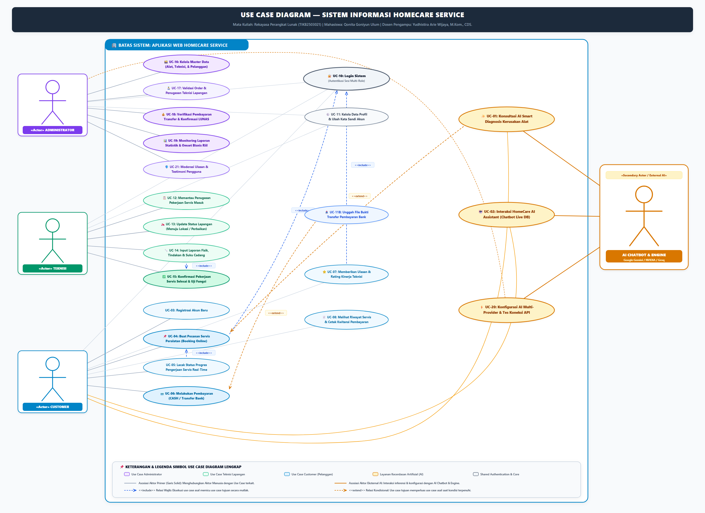

# 📐 Dokumentasi Lengkap Use Case Diagram UML — HomeCare Service

**Mata Kuliah:** Rekayasa Perangkat Lunak (TIKB2503021) — Semester 3  
**Institusi:** Program Studi S1 Teknik Informatika, STMIK IKMI Cirebon  
**Dosen Pengampu:** Yudhistira Arie Wijaya, M.Kom., CDS.  
**Mahasiswa:** Qonita Goniyun Ulum  
**Pengerjaan:** Mandiri (*100% Individual Ownership & Full-App Build*)

---

## 🖼️ Gambar Use Case Diagram UML

---

## 📌 Dekomposisi 4 Aktor Sistem (*System Actors*)

Sistem mengidentifikasi **4 Aktor** utama yang terbagi secara tegas: **3 Aktor Primer Manusia** dan **1 Aktor Sekunder / Sistem AI Eksternal**:

### 👈 Aktor Primer Manusia

| No | Aktor Primer | Simbol & Peran dalam Sistem |
|:--:|---|---|
| 1 | **ADMINISTRATOR** | *Stickman Ungu Violet* — Pengelola operasional tingkat tinggi yang mengelola data master (kategori alat, teknisi, customer), memvalidasi order masuk, menetapkan penugasan teknisi lapangan, memverifikasi bukti bayar transfer bank, memantau laporan analitik omset riil, memoderasi ulasan, serta mengatur konfigurasi AI multi-provider. |
| 2 | **TEKNISI** (*Technician*) | *Stickman Hijau Emerald* — Mitra kerja teknisi lapangan yang memantau pekerjaan servis masuk yang ditugaskan kepadanya, memperbarui status pengerjaan saat di lokasi (*Menuju Lokasi / Sedang Diperbaiki*), menginput laporan fisik (analisis kerusakan & suku cadang), serta mengonfirmasi penyelesaian pekerjaan setelah uji fungsi. |
| 3 | **CUSTOMER** (*Pelanggan*) | *Stickman Biru Langit* — Pemilik peralatan rumah tangga yang menggunakan aplikasi untuk registrasi akun, konsultasi diagnosis awal kerusakan alat via AI, berinteraksi dengan AI virtual assistant, memesan jadwal servis (*booking online*), memantau progres servis secara real-time, melakukan pembayaran (*Cash/Transfer*), dan memberikan rating ulasan. |

---

### 👉 Aktor Sekunder / Sistem Eksternal

| No | Aktor Sekunder | Tipe Aktor | Simbol & Peran dalam Sistem |
|:--:|---|---|---|
| 4 | **AI CHATBOT & ENGINE** *(Google Gemini / NVIDIA NIM / Groq / OpenAI)* | **External AI System** | *Stickman Kuning Amber* — Sistem kecerdasan buatan eksternal yang diintegrasikan melalui API: memproses inferensi keluhan kerusakan alat dan menentukan estimasi biaya (*AI Smart Diagnosis*), memproses dialog asisten virtual interaktif dua arah berbasis konteks basis data *live* (*HomeCare AI Assistant*), serta melayani pengujian koneksi API dan pemilihan model aktif dari Administrator. |

---

## 📋 Daftar Rincian 20 Use Case Sesuai Fitur Website

### 1. Klaster Administrator (Ungu Violet)
* **UC-16: Kelola Master Data (Alat, Teknisi, & Pelanggan):** Mengelola katalog peralatan rumah tangga, tarif dasar perbaikan, data teknisi, dan daftar pelanggan terdaftar.
* **UC-17: Validasi Order & Penugasan Teknisi Lapangan:** Meninjau pesanan customer dan menetapkan teknisi yang sesuai dengan spesialisasi alat.
* **UC-18: Verifikasi Pembayaran Transfer & Konfirmasi LUNAS:** Memvalidasi bukti mutasi transfer perbankan dan mengonfirmasi pelunasan tagihan menjadi `PAID`.
* **UC-19: Monitoring Laporan Statistik & Omset Bisnis Riil:** Dashboard grafik analitik pendapatan, total omset lunas, dan performa pesanan servis secara akurat.
* **UC-21: Moderasi Ulasan & Testimoni Pengguna:** Memantau ulasan bintang dan memfilter testimoni yang masuk.

### 2. Klaster Teknisi Lapangan (Hijau Emerald)
* **UC-12: Memantau Penugasan Pekerjaan Servis Masuk:** Melihat jadwal dan rincian servis yang ditugaskan oleh admin.
* **UC-13: Update Status Lapangan (Menuju Lokasi / Perbaikan):** Mengubah status pengerjaan menjadi `ON_THE_WAY` dan `IN_PROGRESS` saat teknisi bergerak atau memulai perbaikan di rumah customer.
* **UC-14: Input Laporan Fisik, Tindakan & Suku Cadang:** Mengisi formulir laporan inspeksi fisik mengenai penyebab kerusakan komponen dan biaya suku cadang pengganti.
* **UC-15: Konfirmasi Pekerjaan Servis Selesai & Uji Fungsi:** Memastikan alat beroperasi normal kembali dan menandai pesanan selesai (`COMPLETED`).

### 3. Klaster Customer / Pelanggan (Biru Langit)
* **UC-03: Registrasi Akun Baru:** Pendaftaran akun pengguna baru dengan validasi format data dan enkripsi kata sandi.
* **UC-04: Buat Pesanan Servis Peralatan (Booking Online):** Formulir pemesanan perbaikan alat rumah tangga dengan pemilihan jenis perangkat, alamat penjemputan/servis, dan jadwal kedatangan.
* **UC-05: Lacak Status Progres Pengerjaan Servis Real-Time:** Memantau linimasa tahapan servis (*Pending → Confirmed → On The Way → In Progress → Completed*).
* **UC-06: Melakukan Pembayaran (CASH / Transfer Bank):** Melunasi tagihan perbaikan baik secara tunai (*Cash on Delivery*) maupun transfer bank (BCA, Mandiri, BRI, QRIS).

### 4. Klaster Shared & Core Services (Abu-abu Slate)
* **UC-10: Login Sistem (Autentikasi Sesi Multi-Role):** Autentikasi sesi terpusat dengan proteksi hak akses untuk Administrator, Teknisi, dan Customer.
* **UC-11: Kelola Data Profil & Ubah Kata Sandi Akun:** Pengaturan data pribadi dan keamanan akun masing-masing pengguna.
* **UC-11B: Unggah File Bukti Transfer Pembayaran Bank:** Pengunggahan berkas bukti transfer bagi customer yang memilih metode pembayaran transfer bank.
* **UC-07: Memberikan Ulasan & Rating Kinerja Teknisi:** Pemberian rating 1–5 bintang dan review kepuasan terhadap hasil kerja teknisi setelah servis selesai.
* **UC-08: Melihat Riwayat Servis & Cetak Kwitansi Pembayaran:** Melihat arsip seluruh servis yang pernah dilakukan dan mengunduh struk kwitansi berstempel lunas.

### 5. Klaster Layanan Kecerdasan Artifisial (Kuning Amber)
* **UC-01: Konsultasi AI Smart Diagnosis Kerusakan Alat:** Input gejala kerusakan → AI Engine menganalisis kemungkinan kerusakan komponen, tingkat prioritas, estimasi biaya wajar, dan saran tindakan awal yang aman bagi pemilik rumah.
* **UC-02: Interaksi HomeCare AI Assistant (Chatbot Live DB):** Percakapan asisten virtual cerdas yang terhubung langsung dengan basis data sistem (omset lunas, status pesanan, ketersediaan teknisi, katalog alat).
* **UC-20: Konfigurasi AI Multi-Provider & Tes Koneksi API:** Pengaturan API Key dan pemilihan model aktif (Google Gemini, NVIDIA NIM, Groq, OpenAI) oleh Administrator disertai tombol pengujian koneksi langsung (*live ping*).

---

## 🔗 Relasi Stereotipe UML (`<<include>>` & `<<extend>>`)

1. **Relasi `<<include>>` (Relasi Wajib):**
   * `Buat Pesanan Servis (UC-04)` $\xrightarrow{\ll include\gg}$ `Login Sistem (UC-10)`: Customer wajib terautentikasi sebelum dapat menerbitkan pesanan servis.
   * `Lacak Status Progres (UC-05)` $\xrightarrow{\ll include\gg}$ `Buat Pesanan Servis (UC-04)`: Linimasa pemantauan status hanya dapat diakses untuk pesanan yang sudah tercatat.
   * `Memberikan Ulasan (UC-07)` $\xrightarrow{\ll include\gg}$ `Login Sistem (UC-10)`: Autentikasi diperlukan untuk memastikan review berasal dari pemilik akun yang sah.
   * `Input Laporan Fisik (UC-14)` $\xrightarrow{\ll include\gg}$ `Konfirmasi Pekerjaan Selesai (UC-15)`: Teknisi wajib melengkapi catatan inspeksi dan tindakan sebelum pesanan ditutup tuntas.

2. **Relasi `<<extend>>` (Relasi Kondisional / Opsional):**
   * `Konsultasi AI Diagnosis (UC-01)` $\xrightarrow{\ll extend\gg}$ `Buat Pesanan Servis (UC-04)`: Hasil diagnosis kerusakan dapat diperluas menjadi pemesanan servis resmi melalui tombol Call-to-Action (*otomatis menyalin data alat dan keluhan*).
   * `Unggah Bukti Transfer (UC-11B)` $\xrightarrow{\ll extend\gg}$ `Melakukan Pembayaran (UC-06)`: Form unggah slip bukti bayar hanya dieksekusi secara opsional apabila customer memilih jalur pembayaran transfer bank (bukan Cash).

